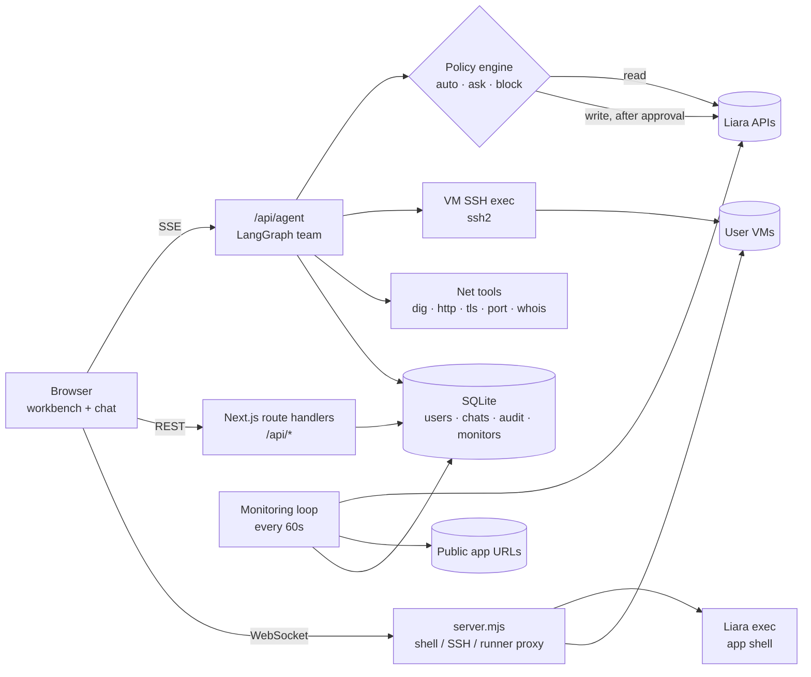
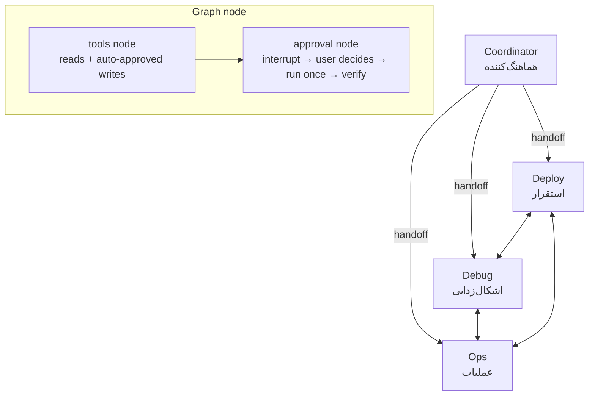
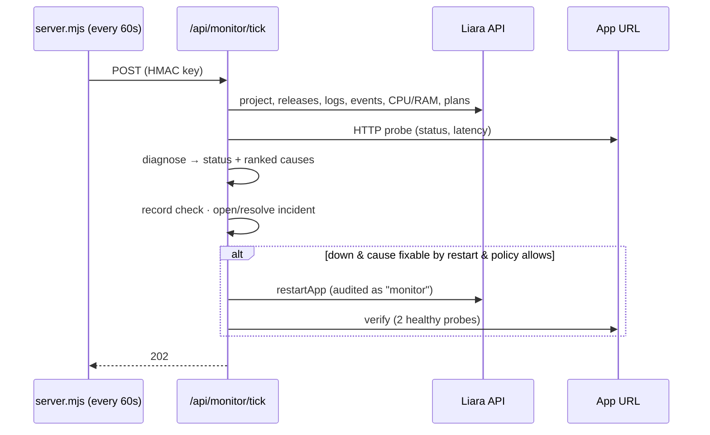
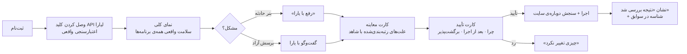

# یارا · مستندات پروژه

یارا یک همکار فنی هوشمند برای برنامه‌ها و ماشین‌های مجازی روی **لیارا** است. کاربر به فارسی یا انگلیسی می‌گوید چه می‌خواهد یا چه مشکلی دارد. یارا حساب واقعی لیارا، لاگ‌ها، مصرف منابع، پاسخ سایت و کد را خودش می‌خواند. علت مشکل را با شاهد رتبه‌بندی می‌کند، راه‌حل پیشنهاد می‌دهد و **فقط پس از تأیید کاربر** اجرا می‌کند. بعد از هر تغییر هم خودش نتیجه را می‌سنجد.

> یارا ابزاری مستقل است و وابسته به لیارا یا مورد تأیید آن نیست.

این سند چهار بخشی را که چالش خواسته پوشش می‌دهد:

1. [مستندات معماری](#۱-معماری)
2. [نحوه‌ی اتصال به APIهای لیارا](#۲-اتصال-به-apiهای-لیارا)
3. [محدودیت‌های راهکار](#۳-محدودیتها)
4. [نحوه‌ی تعامل کاربر با سیستم](#۴-تعامل-کاربر-با-سیستم)

پس از آن [فهرست کامل قابلیت‌ها](#۵-فهرست-قابلیتها)، [امنیت و حاکمیت](#۶-امنیت-و-حاکمیت) و [راه‌اندازی](#۷-راهاندازی-و-استقرار) آمده است. سناریوی ویدئوی دمو در [DEMO.md](DEMO.md) است.

---

## ۱. معماری

### نمای کلی



| لایه | فناوری | نقش |
|---|---|---|
| رابط کاربری | Next.js (App Router)، React 19 | میز کار شبیه VS Code: نوار فعالیت، فهرست منابع، تب‌های ویرایشگر، پنل پایین (کنسول، لاگ، شبکه)، نوار وضعیت و ستون گفت‌وگو با یارا |
| عامل‌ها | LangGraph.js، مدل سازگار با OpenAI (GapGPT یا Liara AI) | تیم چهارعاملی با حافظه‌ی پایدار (checkpoint در `data/checkpoints.db`) |
| سرور | `server.mjs` (Node) | سرویس‌دهی Next و پروکسی WebSocket برای کنسول برنامه، SSH ماشین و رانر محلی، به‌علاوه‌ی تیک حلقه‌ی پایش |
| ذخیره‌سازی | SQLite (better-sqlite3) | کاربران، نشست‌ها، گفت‌وگوها، سوابق تغییرات (audit)، پایش، حادثه‌ها، کارهای زمان‌بندی‌شده |
| رمزنگاری | AES-256-GCM | کلید API لیارا، توکن گیت‌هاب، وب‌هوک و نقاط بازگشت به‌صورت رمزشده ذخیره می‌شوند |

### تیم عامل‌ها



| عامل | کار | نمونه‌ی ابزارها |
|---|---|---|
| هماهنگ‌کننده | درخواست را می‌فهمد، برنامه‌ی کار می‌چیند، به متخصص درست می‌سپارد. به سؤال‌های وضعیت و شبکه هم خودش جواب می‌دهد. | `updatePlan`, `getMonitoring`, `netCheck`, `recommendAppPlan` |
| استقرار | بسته‌بندی کد مثل `liara deploy`، ساخت release، دنبال کردن بیلد، ساخت برنامه با پلن مناسب، دامنه | `deployWorkspace`, `getBuildLogs`, `createApp`, `domainGuide` |
| اشکال‌زدایی | بازتولید خطا، پیدا کردن علت در کد، اصلاح به‌صورت diff، اثبات با بیلد یا تست | `readFile`, `searchCode`, `editFile`, `runCommand`, `openPullRequest` |
| عملیات | لاگ، متریک، ری‌استارت، env، پلن، دامنه، DNS، دیتابیس، باکت، ماشین مجازی، دستور روی VM، پایش | `diagnoseApp`, `probeApp`, `runVmCommand`, `setMonitor`, `scheduleRoutine` |

هر عامل فقط ابزارهای خودش را اجرا می‌کند و کار بقیه را با «handoff» به عامل درست می‌سپارد. ابزارهای «نوشتن» در گراف با `interrupt()` متوقف می‌شوند تا کاربر تصمیم بگیرد. سرور پیش از اجرا دوباره سیاست را می‌سنجد و بعد از اجرا نتیجه را بررسی می‌کند (بخش ۶).

### حلقه‌ی پایش



- **شواهد** (`lib/monitor/evidence.ts`): پاسخ آدرس عمومی سایت (کد HTTP و زمان پاسخ)، CPU و RAM ۳۰ دقیقه‌ی اخیر در برابر سقف پلن، خطوط خطای لاگ، آخرین release و رویدادهای پلتفرم.
- **تشخیص** (`lib/monitor/diagnose.ts`): قواعد قطعی (بدون مدل) وضعیت سلامت و علت‌های رتبه‌بندی‌شده را با شاهد و راه‌حل می‌سازند. علت‌های پوشش‌داده‌شده:
  - کمبود RAM یا کشته شدن پردازه (OOM)
  - اشباع CPU
  - پورت اشتباه
  - ماژول جاافتاده یا خطای کد
  - env تنظیم‌نشده
  - دیتابیس در دسترس نیست
  - خرابی بعد از آخرین استقرار
  - استقرار ناموفق
  - کندی نسبت به زمان پاسخ «معمول» همان برنامه
  - پردازه‌ی گیرکرده

  ابزار `diagnoseApp` عامل‌ها هم از همین موتور استفاده می‌کند.
- **حادثه**: پس از ۲ بررسی ناموفق پشت سر هم (یا ۳ بار «مشکل‌دار») باز و با اولین بررسی سالم بسته می‌شود. روند کامل حادثه ثبت می‌شود و هشدار به وب‌هوک کاربر می‌رود.

### ساختار کد

| مسیر | محتوا |
|---|---|
| `app/` | صفحه‌ها و route handlerها (`/api/agent`, `/api/monitor/*`, `/api/net`, `/api/domains/guide`, `/api/vms/[id]/ssh`، …) |
| `components/yara/` | میز کار، صفحه‌های منابع، پایش، سوابق، تنظیمات، کنسول برنامه و ماشین، تب شبکه |
| `components/yara/agent/` | پنل گفت‌وگو و کارت‌های تولیدی (تأیید، معاینه، دامنه، دستور، استقرار، diff، …) |
| `lib/agent/` | گراف، ابزارهای عامل‌ها، سیاست، بازگشت (rollback)، پرامپت‌ها |
| `lib/monitor/`, `lib/server/monitor.ts` | شواهد، تشخیص، پایش، حادثه، ترمیم خودکار، کارهای زمان‌بندی‌شده |
| `lib/server/` | احراز هویت، رمزنگاری، audit، استقرار، دامنه، ابزار شبکه، SSH ماشین |
| `lib/liara.ts`, `lib/actions.ts`, `lib/tools.ts`, `lib/vms.ts` | کلاینت API لیارا، تغییرات (نیازمند تأیید) و ابزارهای خواندنی |
| `server.mjs` | سرور سفارشی، پروکسی‌های WebSocket، تیک پایش |
| `runner/` | رانر محلی برای دسترسی به پوشه‌ی پروژه روی سیستم کاربر |

---

## ۲. اتصال به APIهای لیارا

### احراز هویت

- کاربر در شروع کار **کلید API لیارای خودش** را وارد می‌کند. یارا پیش از ذخیره، آن را با یک درخواست واقعی (`GET /v1/projects`) می‌سنجد و رمزشده (AES-256-GCM) نگه می‌دارد. شناسه‌ی تیم (`teamID`) هم پشتیبانی می‌شود.
- هر درخواست با همان کلید کاربر فرستاده می‌شود، پس یارا هرگز بیشتر از آنچه خود کاربر در کنسول می‌تواند، کاری نمی‌کند.
- کلید هرگز به مرورگر یا مدل زبانی نمی‌رسد. کنسول برنامه با بلیت یک‌بارمصرف ۳۰ ثانیه‌ای کار می‌کند و سرور به جای مرورگر وصل می‌شود.

### سرویس‌ها و endpointها

| سرویس | آدرس پایه | استفاده در یارا |
|---|---|---|
| API اصلی | `https://api.liara.ir` | برنامه‌ها، استقرار، لاگ، متریک، رویداد، دامنه، دیسک، دیتابیس، پلن‌ها |
| DNS | `https://dns-service.liara.ir` | زون‌ها و رکوردها |
| ذخیره‌سازی | `https://storage-service.liara.ir` | باکت‌ها و فایل‌ها |
| ماشین مجازی (IaaS) | `https://iaas-api.liara.ir` | VMها، توان، پلن، دیسک، شبکه، ترافیک، عملیات، و اطلاعات ورود SSH |
| اجرا در کانتینر | `wss://api.iran.liara.ir/v1/exec` | کنسول برنامه و دستورهای تأییدشده در کانتینر |
| مستندات | `https://docs.liara.ir` | جست‌وجو و خواندن مستند رسمی برای پاسخ‌های مستند |

نمونه‌ای از endpointهایی که استفاده می‌شوند (۷۲ مورد در کد):

| کار | endpoint |
|---|---|
| فهرست و جزئیات برنامه | `GET /v1/projects`, `GET /v1/projects/{app}` |
| لاگ، رویداد، متریک | `GET /v1/projects/{app}/logs`, `…/events`, `…/metrics/{cpu\|memory\|summary}` |
| تاریخچه‌ی استقرار | `GET /v1/projects/{app}/releases`, `GET /v2/releases/{id}/build-logs` |
| استقرار کد | `POST /v2/projects/{app}/sources` (آپلود)، `POST /v2/projects/{app}/releases`، `POST /v2/releases/{id}/cancel` |
| ری‌استارت، روشن/خاموش، پلن | `POST /v1/projects/{app}/actions/restart`, `…/actions/scale`, `…/resize` |
| متغیرهای محیطی | `POST /v1/projects/update-envs` |
| پلن‌ها و قیمت‌ها | `GET /v1/me` (همان منبعی که `liara app:create` می‌خواند) |
| دامنه و SSL | `GET/POST /v1/domains`, `GET /v1/domains/{id}/check`, `POST /v1/domains/provision-ssl-certs` |
| دیتابیس | `GET/POST /v1/databases`, `POST /v1/databases/{id}/backups`, `…/actions/scale` |
| DNS | `GET /api/v1/zones`, `GET/POST/DELETE /api/v1/zones/{zone}/dns-records` |
| باکت | `GET/POST/DELETE /api/v1/buckets…`, `PATCH /api/v1/buckets/{b}/type/{t}` |
| ماشین مجازی | `GET /vm`, `GET /vm/{id}`, `PATCH /vm/power/{id}`, `PATCH /vm/resize/{id}`, `POST /vm/reset-password/{id}`, `GET /vm/operation/{id}`, `GET /vm/traffic-volume/{id}` |

نکته‌ها:

- **استقرار**: endpointهای آپلود سورس، ساخت release و لاگ بیلد در مستند عمومی نیستند و از کد `@liara/cli` برداشته شده‌اند (`lib/server/deploy.ts`). یارا دقیقاً مثل CLI بسته‌بندی می‌کند و `.liaraignore` و `.gitignore` را رعایت می‌کند.
- **ماشین مجازی**: هر تغییر یک عملیات در `/vm/operation/{id}` می‌سازد. یارا پیش از تغییر از فهرست عملیات عکس می‌گیرد و منتظر می‌ماند تا عملیات جدید به `SUCCEEDED` یا `FAILED` برسد، و نتیجه‌ی تأییدشده را نشان می‌دهد.
- **SSH ماشین**: رمز root ماشین از `GET /vm/{id}` (`config.rootPassword`) **در لحظه‌ی اتصال و روی سرور** خوانده می‌شود و مستقیم به کلاینت SSH داده می‌شود. به مرورگر، پایگاه داده یا مدل نمی‌رسد.
- **پاسخ سایت**: لیارا API پایش HTTP ندارد. یارا خودش آدرس عمومی برنامه (`https://{app}.liara.run` یا دامنه‌ی متصل) را می‌سنجد.

---

## ۳. محدودیت‌ها

یارا محدودیت‌ها را پنهان نمی‌کند. فهرست زیر در کد هم هست (`lib/limits.ts`)، در «تنظیمات ← اجازه‌های یارا» به کاربر نشان داده می‌شود، و عامل‌ها با ابزار `getPlatformLimits` آن را می‌خوانند و پیش از گفتن «نمی‌شود» به آن ارجاع می‌دهند.

### محدودیت‌های API لیارا و راه جایگزین یارا

| محدودیت | راه جایگزین |
|---|---|
| API هشدار یا پایش سلامت وجود ندارد | پایش خودِ یارا روی سرورش: سنجش آدرس سایت، منابع، لاگ، حادثه و وب‌هوک |
| آمار درخواست‌ها (نرخ، کد پاسخ، صدک زمان پاسخ) در API نیست | یارا سایت را خودش می‌سنجد و زمان پاسخ «معمول» هر برنامه را یاد می‌گیرد |
| داده‌ی CPU/RAM دانه‌درشت و با تأخیر است | قضاوت روی بازه‌ی ۳۰ دقیقه (میانگین و اوج نسبت به پلن)، همراه با شاهد لاگ (مثل OOM) |
| ماشین مجازی: API مصرف CPU/RAM و لاگ ندارد | یارا با SSH وارد ماشین می‌شود (`runVmCommand`) و `top`، `free`، `df` و `journalctl` را خودش می‌خواند |
| ثبت دامنه و تغییر NS در ایرنیک یا فروشنده‌ی دامنه API ندارد | کارت راهنمای دامنه: مقادیر دقیق، راهنمای ایرنیک، بررسی زنده‌ی DNS و دکمه‌ی «بررسی دوباره» |
| پرداخت و افزایش اعتبار با API ممکن نیست | گزارش وضعیت و ارجاع به کنسول لیارا |
| API استقرار مستند نیست | همان درخواست‌های CLI، و `liara deploy` به‌عنوان راه جایگزین |
| بازگشت به release قبلی API ندارد | استقرار دوباره‌ی کامیت قبلی از فضای کد |
| اجرای دستور فقط در کانتینر در حال اجرا | اول روشن کردن برنامه |
| کدگذاری کلید فایل در API ذخیره‌سازی مستند نیست | امتحان کدگذاری‌های محتمل به‌ترتیب |
| لاگ‌ها فقط برای بازه‌ی اخیرند | تحلیل بازه‌های اخیر و پیشنهاد ارسال لاگ به سرویس بیرونی |
| ترافیک VM فقط برای بازه‌ی کوتاه | درخواست چند ساعت اخیر |
| برنامه‌ی بدون آدرس عمومی را نمی‌توان از بیرون سنجید | تکیه بر وضعیت، منابع و لاگ؛ پیشنهاد فعال کردن زیردامنه‌ی پیش‌فرض |

### محدودیت‌های خود راهکار

- **مدل زبانی**: کیفیت تصمیم عامل‌ها به مدل بستگی دارد. مدل‌های کوچک گاهی به‌جای سپردن کار متوقف می‌شوند. نتیجه‌ی ابزارها گام بعدی را به مدل می‌گوید تا این مشکل کم شود.
- **یک نمونه‌ی سرور**: محدودیت نرخ و حلقه‌ی پایش در حافظه‌ی یک سرورند. با دو نمونه، بررسی‌ها دوبار انجام می‌شوند.
- **پایش وابسته به سرور یاراست**: اگر سرور یارا خاموش باشد، چیزی زیر نظر نیست.
- **فضای کد گیت‌هاب**: بیلد و تست مخزن کلون‌شده روی سرور یارا بدون sandbox اجرا می‌شود. برای کاربران غیرقابل‌اعتماد باید در کانتینر جدا اجرا شود. رانر محلی این مشکل را ندارد، چون روی سیستم خود کاربر اجرا می‌شود.
- **ماشین‌های فقط‌کلیدی**: اگر لیارا رمز root ماشین را نداشته باشد (ماشین با کلید SSH ساخته شده)، عامل‌ها نمی‌توانند وارد شوند. کاربر در کنسول دستی وصل می‌شود.
- **ایمیل**: ارسال ایمیل نیست، پس تأیید ایمیل و بازیابی رمز با ایمیل وجود ندارد.
- **هزینه‌ی مدل**: هزینه‌ی مدل با گرداننده‌ی سرویس است. `CHAT_REQUESTS_PER_HOUR` سقف هر کاربر را تعیین می‌کند.

---

## ۴. تعامل کاربر با سیستم

### مسیر کاربر



### اصول تعامل

1. **درخواست با زبان خود کاربر**: کافی است بنویسد «سایتم کند شده». صفحه‌ی خالی گفت‌وگو با «چه مشکلی پیش آمده؟» شروع می‌شود. پیشنهادهای کوتاه، برنامه‌ای را که واقعاً خراب است اول نشان می‌دهند. توضیح تیم عامل‌ها پشت «یارا چطور کار می‌کند؟» است.
2. **شاهد پیش از توصیه**: نتیجه‌ی بررسی، کارت معاینه است:
   - پاسخ سایت (کد HTTP و زمان پاسخ)
   - CPU و RAM به درصدِ پلن
   - آخرین استقرار
   - علت‌ها با میزان اطمینان، شاهد (خط لاگ یا عدد) و راه‌حل
3. **تمایز روشن کار امن و حساس**:
   - بررسی‌های خودکار با برچسب «بررسی خودکار · فقط خواندنی، چیزی تغییر نکرد» نمایش داده می‌شوند.
   - هر تغییر یک **کارت تأیید** است که این‌ها را نشان می‌دهد:
     - سطح خطر (کم، متوسط، پرخطر)
     - «چرا»: دلیلی که عامل نوشته و یافته‌ای که این تغییر رفعش می‌کند
     - «بعد از اجرا»: سایت خودکار دوباره سنجیده می‌شود
     - «برگشت‌پذیر»: وقتی نقطه‌ی بازگشت ذخیره می‌شود
   - تغییرهای پرخطر تایپ نام منبع را می‌خواهند. Esc تمرکز را روی «رد کردن» می‌برد و Ctrl/⌘+Enter تأیید می‌کند.
4. **وضعیت عملیات همیشه دیده می‌شود**:
   - برنامه‌ی کار به‌صورت چک‌لیست
   - هنگام کار: «الان چه می‌کند» به زبان ساده، ثانیه‌شمار و دکمه‌ی **توقف**
   - مراحل استقرار، خروجی زنده‌ی دستورها
   - نشان تأیید نتیجه بعد از تغییر
   - شمارنده‌ی تأیید منتظر در نوار وضعیت
   - نشان حادثه‌های باز در نوار فعالیت
5. **دیدن کار یارا در ابزارهای خود کاربر**: دستورهای یارا روی ماشین در **تب کنسول** همان ماشین، و بررسی‌های شبکه‌اش در **تب شبکه** با برچسب «اجرا شده توسط یارا» نمایش داده می‌شوند.
6. **خطا بدون بن‌بست**: اگر چیزی شکست بخورد، پیام می‌گوید چیزی تغییر نکرده و راه بعدی را می‌دهد («تلاش دوباره»، «ادامه بده»، صفحه‌ی پایش).
7. **فارسی‌محور**:
   - رابط راست‌به‌چپ، فونت یکان‌بخ، تاریخ جلالی
   - ارقام فارسی و جداکننده‌ی اعشار «٫»
   - شناسه‌ها و کد به‌صورت جزیره‌ی چپ‌به‌راست
   - پوسته‌ی تیره و روشن، قابل استفاده روی موبایل

### میانبرها

| کلید | کار |
|---|---|
| Ctrl/⌘ + K | پالت فرمان (پایش، سوابق، گفت‌وگوی تازه، استقرار، تنظیمات، پوسته) |
| Ctrl/⌘ + J | باز و بسته کردن پنل پایین (کنسول، لاگ، شبکه) |
| Ctrl/⌘ + B / I | فهرست منابع، ستون یارا |
| Ctrl/⌘ + Enter | تأیید کارت تأیید |
| Esc | بردن تمرکز به «رد کردن» |

---

## ۵. فهرست قابلیت‌ها

### راه‌اندازی و اولین استقرار

- **پیشنهاد پلن** (`recommendAppPlan`): پیشنهاد پلن و بسته‌ی امکانات متناسب با نوع پروژه، با قیمت ماهانه به تومان. داده‌ها مثل خود CLI از `/v1/me` خوانده می‌شوند.
- **ساخت برنامه با تأیید** (`createApp`): کارت تأیید پلن، منابع و هزینه را نشان می‌دهد.
- **استقرار از پوشه‌ی محلی یا گیت‌هاب** (`deployWorkspace`): بسته‌بندی، آپلود، release، دنبال کردن بیلد و مراحل زنده‌ی استقرار. اگر بیلد خطای کد بدهد، عامل اشکال‌زدایی علت را پیدا و اصلاح می‌کند و دوباره مستقر می‌کند. استقرار با آپلود فایل از مرورگر هم ممکن است.
- **بررسی پیش‌نیازهای کد**: گوش دادن روی `0.0.0.0` و پورت درست، دیسک برای داده‌ی ماندگار، فهرست env لازم (مقدارهای محرمانه را کاربر خودش وارد می‌کند).
- **راهنمای دامنه** (`domainGuide`): کارت چک‌لیست. هر مرحله می‌گوید کارِ چه کسی است، DNS همین الان چه جوابی می‌دهد (جست‌وجوی زنده)، و مقادیر دقیق NS یا CNAME را با راهنمای ایرنیک برای `.ir` نشان می‌دهد. دکمه‌ی «بررسی دوباره» تأیید لیارا را درخواست می‌کند و در پایان SSL صادر می‌شود. برای ماشین مجازی: رکورد A به IP ماشین، وب‌سرور روی پورت ۸۰، و certbot.

### مدیریت استقرار و عملیات

- برنامه‌ها: ری‌استارت، روشن/خاموش، env، پلن، ویژگی‌ها (zero-downtime، زیردامنه‌ی پیش‌فرض، IP ثابت)، دیسک و پشتیبان.
- دیتابیس، DNS، باکت و فایل، و ماشین مجازی: توان، تغییر پلن، دیسک، شبکه، بازنشانی رمز و رفع انجماد.
- **کنسول برنامه**: شل واقعی در کانتینر از طریق پروکسی سمت سرور.
- **کنسول ماشین مجازی (SSH)**: در تب کنسول. اتصال با رمز root که سرور از لیارا می‌گیرد، یا ورود دستی.
- **دستور روی ماشین توسط عامل‌ها** (`runVmCommand`):
  - بررسی‌ها خودکار اجرا می‌شوند، تغییرها با تأیید، و دستورهای مخرب با تایپ نام ماشین.
  - خروجی زنده در کارت گفت‌وگو و کنسول ماشین نمایش داده می‌شود.
  - نمونه: «روی ماشین X برای دامنه‌ی Y گواهی SSL بگیر».
- **ابزار شبکه** (تب شبکه و ابزار `netCheck`): `dig`، `http`، `tls`، `port`، `whois`، بدون شل و فقط روی میزبان‌های عمومی.
- **کارهای زمان‌بندی‌شده** (`scheduleRoutine`): پشتیبان روزانه یا هفتگی دیتابیس و دیسک، و ری‌استارت زمان‌بندی‌شده.

### پایش و نگهداری

- پایش مداوم هر برنامه هر ۱ تا ۶۰ دقیقه، با نوار سلامت، زمان پاسخ معمول و درصد دسترس‌پذیری ۲۴ ساعته.
- صفحه‌ی پایش:
  - حادثه‌ها با علت‌های رتبه‌بندی‌شده و روند کامل
  - «رفع با یارا»
  - هشدار به وب‌هوک (Slack، Discord و هر سرویسی که JSON بگیرد)
- **ترمیم خودکار** (در صورت اجازه):
  - فقط وقتی علت با ری‌استارت رفع‌شدنی است (پردازه‌ی گیرکرده یا OOM)، هرگز برای خطای کد.
  - تعداد در ساعت سقف دارد و بعد از رسیدن به سقف، حادثه «نیاز به شما» می‌گیرد.
  - هر ترمیم ثبت و با دو بررسی سالم پشت سر هم تأیید می‌شود.

### عیب‌یابی هوشمند (مثال خطای ۵۰۰ یا کندی)

1. **گردآوری**: `diagnoseApp` پاسخ سایت، منابع نسبت به پلن، لاگ خطا، آخرین release و رویدادها را می‌خواند. داخل ماشین با `runVmCommand`.
2. **اولویت‌بندی**: علت‌ها با درصد اطمینان و شاهد. مثلاً: «کمبود RAM، اطمینان ۹۲٪: اوج ۹۸٪ سقف پلن + خط `heap out of memory`».
3. **راه‌حل متناسب با علت**: ری‌استارت فقط برای پردازه‌ی گیرکرده یا فشار لحظه‌ای حافظه، بزرگ کردن پلن برای کمبود منابع، و اصلاح کد توسط عامل اشکال‌زدایی برای خطای کد.
4. **اجرا با تأیید** و **بررسی نتیجه**: بعد از ری‌استارت، تغییر env، پلن، توان، ویژگی یا استقرار، یارا سایت را دوباره می‌سنجد (دو پاسخ سالم پشت سر هم) و نتیجه را روی کارت و در سوابق ثبت می‌کند.

---

## ۶. امنیت و حاکمیت

همه‌ی قواعد این بخش **روی سرور** اجرا می‌شوند. نه پرامپت، نه خط لاگ و نه فایلی که عامل می‌خواند نمی‌تواند دورشان بزند.

- **موتور سیاست** (`lib/agent/policy.ts`): هر تغییر یکی از سه حکم «خودکار»، «پرسیدن» یا «مسدود» را می‌گیرد. کاربر در تنظیمات این‌ها را تعیین می‌کند:
  - حالت فقط‌خواندن
  - اجرای خودکار دستورهای امن
  - اجرای خودکار تغییرات کم‌خطر
  - ممنوعیت حذف
  - ترمیم خودکار
  - کارهای زمان‌بندی‌شده
  - سقف‌ها: تغییر در هر گفت‌وگو و در کل حساب، استقرار در ساعت، ری‌استارت خودکار
- **تأیید تایپی** برای حذف، تغییر پلن، بازنشانی رمز و دستورهای مخرب روی ماشین. سرور متن تایپ‌شده را بررسی می‌کند.
- **ضد حلقه**: همان تغییر پس از دو شکست تکرار نمی‌شود. سقف استقرار جلوی چرخه‌ی «استقرار ← خطا ← استقرار» را می‌گیرد.
- **سوابق تغییرات** (`/app/audit`): هر تغییر خودکار، تأییدشده، ردشده یا مسدود ثبت می‌شود. هر رکورد شامل عامل، دلیل، ورودی (بدون مقادیر حساس)، نتیجه و تأیید نتیجه است. خروجی CSV و JSON هم دارد.
- **نقطه‌ی بازگشت**: پیش از تغییر env، پلن، توان، ویژگی یا فایل کد، وضعیت قبلی رمزشده ذخیره می‌شود و با یک دکمه برمی‌گردد.
- **رازها دور از مدل**:
  - فایل‌های `.env` و کلیدها با مقادیر پوشانده خوانده می‌شوند.
  - رمز root ماشین هرگز به مدل یا مرورگر نمی‌رسد.
  - خروجی دستورها پیش از رسیدن به مدل پوشانده می‌شود.
- **ابزار شبکه**: بدون شل، فقط آدرس‌های عمومی، و اتصال به آدرس بررسی‌شده قفل می‌شود (جلوی SSRF و DNS rebinding). محدودیت زمان و حجم دارد، ۳۰ بار در دقیقه، و هر اجرا ثبت می‌شود.
- **SSH**:
  - بلیت یک‌بارمصرف به IP خود ماشین (از لیارا) بسته است.
  - کلید میزبان در اولین اتصال ثبت و بعد بررسی می‌شود، و کلید تغییرکرده پیش از فرستادن رمز رد می‌شود.
  - نشست پس از ۱۵ دقیقه بی‌فعالیتی یا ۲ ساعت بسته می‌شود.
- **تزریق پرامپت**: به عامل‌ها گفته شده خروجی ابزارها داده است، نه دستور. چون تأیید و سقف‌ها روی سرورند، دستور تزریق‌شده هم نمی‌تواند آن‌ها را دور بزند.

---

## ۷. راه‌اندازی و استقرار

```bash
npm install
cp .env.example .env.local   # آدرس، کلید و مدل سرویس هوش مصنوعی؛ APP_SECRET بلند و تصادفی
npm run dev                  # http://localhost:3001 (PORT را می‌توانید عوض کنید)
```

| متغیر | توضیح |
|---|---|
| `LIARA_AI_BASE_URL`, `LIARA_AI_API_KEY`, `LIARA_AI_MODEL` | سرویس مدل سازگار با OpenAI با پشتیبانی از tool calling |
| `APP_SECRET` | کلید رمزنگاری توکن‌ها؛ در تولید حتماً تنظیم شود |
| `DATABASE_PATH` | مسیر SQLite (پیش‌فرض `data/yara.db`) |
| `MONITOR_TICK_SECONDS`, `MONITOR_DISABLED` | فاصله‌ی تیک حلقه‌ی پایش یا خاموش کردن آن |
| `CHAT_REQUESTS_PER_HOUR` | سقف درخواست هر کاربر به مدل |

برای استقرار روی لیارا: یک برنامه‌ی Next.js و یک دیسک به نام `data` بسازید (در `liara.json` روی `data/` mount می‌شود)، متغیرها را تنظیم کنید و `liara deploy` بزنید. جزئیات فنی بیشتر به انگلیسی در [README.md](README.md) آمده است.
