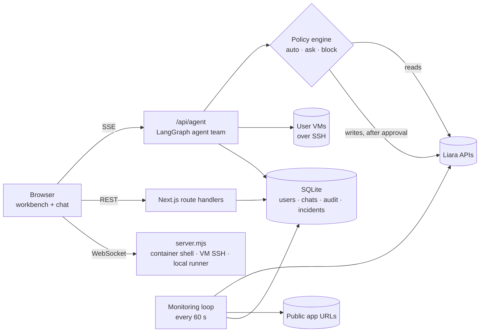
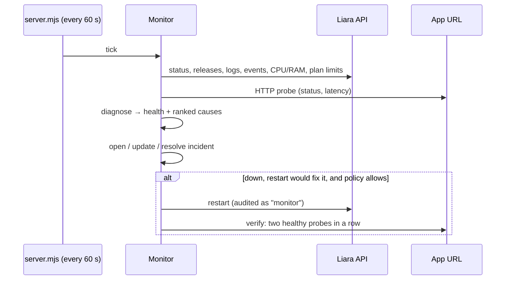

<p align="center">
  
</p>

<h1 align="center">Yara · یارا</h1>

<p align="center">
  <b>An AI DevOps teammate for Liara.</b><br/>
  Tell it what's wrong in plain Persian or English. It reads your real Liara account, finds the cause with evidence,<br/>
  fixes it <i>after you approve</i>, and then proves the fix worked.
</p>

<p align="center">
  <a href="https://yarayara.liara.run"></a>
  <a href="DOCUMENTATION.md"></a>
</p>

<p align="center">
  
  
  
  
</p>

<div dir="rtl">

> **یارا** همکار فنی هوشمند برای صاحبان وب‌سایت روی لیاراست. کاربر فقط می‌نویسد «سایتم ۵۰۰ می‌دهد» یا «سایتم کند شده». یارا لاگ، مصرف CPU و RAM، پاسخ واقعی سایت و آخرین استقرار را از حساب واقعی لیارا می‌خواند، علت‌ها را با شاهد رتبه‌بندی می‌کند، راه‌حل را روی یک کارت تأیید پیشنهاد می‌دهد و **فقط پس از تأیید کاربر** اجرا می‌کند. بعد از اجرا، خودش سایت را دوباره می‌سنجد تا ثابت کند مشکل رفع شده. از اولین استقرار و انتخاب پلن تا پایش مداوم، ترمیم خودکار و راهنمای دامنه‌ی ایرنیک.
>
> مستندات کامل فارسی (معماری، اتصال به APIهای لیارا، محدودیت‌ها و نحوه‌ی تعامل): **[DOCUMENTATION.md](DOCUMENTATION.md)**

</div>

---

## Contents

- [See it in 60 seconds](#see-it-in-60-seconds)
- [How Yara maps to the judging criteria](#how-yara-maps-to-the-judging-criteria)
- [Architecture](#architecture)
- [Governance: who is allowed to change what](#governance-who-is-allowed-to-change-what)
- [The loops: verify, monitor, heal](#the-loops-verify-monitor-heal)
- [Honest about Liara's API](#honest-about-liaras-api)
- [Run it yourself](#run-it-yourself)
- [Known limitations](#known-limitations)

---

## See it in 60 seconds

Open **[yarayara.liara.run](https://yarayara.liara.run)**, sign up, and connect a Liara API token (console.liara.ir → API). Yara checks the token against Liara before it stores it, encrypted.

A typical run against the demo app, start to finish (numbers are illustrative):

```text
You     سایت yara-demo-shop خطای ۵۰۰ می‌دهد

Yara    ▸ plan        1. check the site  2. read logs & resources  3. find the cause  4. fix  5. verify
        ▸ inspect     (read-only, nothing changed)
                      HTTP 500 · 1.8 s     RAM 98% of plan     CPU 41%     last deploy 2 h ago
        ▸ causes      1. Out of memory          92%   log: "JavaScript heap out of memory"
                      2. Regression from deploy 31%   errors started after release #14
        ▸ proposal    Restart now, then move to a larger plan
                      ┌───────────────────────────────────────────────┐
                      │ Restart yara-demo-shop            risk: low   │
                      │ why     frees the leaked memory (cause #1)    │
                      │ after   Yara re-probes the site automatically │
                      │         [ Approve  Ctrl+Enter ]   [ Deny ]    │
                      └───────────────────────────────────────────────┘
You     ✓ approve
Yara    ▸ verified    HTTP 200 · 140 ms, two healthy probes in a row   ✓ result checked
        ▸ audit       recorded with agent, reason, inputs and result
        ▸ offer       turn on continuous monitoring for this app?
```

That's the loop the brief asks for: **collect → rank causes → propose → approve → act → verify**. The demo app in [`demo/faulty-app`](demo/faulty-app) can switch between a memory leak, 500 errors, slowness and healthy, so any judge can reproduce it on their own account.

---

## How Yara maps to the judging criteria

| Criterion | What Yara does | Where |
|---|---|---|
| **Liara integration & real operations** · 100 | Lists and manages apps, releases, env vars, plans, domains/SSL, disks, databases, DNS, object storage and **virtual machines**. Deploys code the way `liara deploy` does (source upload → release → build logs). Recommends a plan with monthly prices in Toman before creating an app. Opens a real shell in the app container and SSH on VMs. | `lib/liara.ts`, `lib/server/deploy.ts`, `lib/actions.ts`, `lib/vms.ts` |
| **Intelligence & problem solving** · 100 | Gathers evidence (URL probe, CPU/RAM vs plan, error logs, last release, events). A deterministic engine ranks causes with confidence and the log line or number behind each one. The debug agent reproduces build failures, fixes your code as a diff and proves it with a build. **Every change is verified afterwards.** | `lib/monitor/evidence.ts`, `lib/monitor/diagnose.ts`, `lib/server/monitor.ts` → `verifyAppHealth` |
| **User experience** · 50 | Chat in your own words. Results come back as cards: inspection, ranked causes, plan checklist, live deploy steps, diff, approval. A live "what it's doing now" line with a stop button. Persian-first RTL UI with Jalali dates, dark and light themes, mobile-friendly. | `components/yara/agent/*` |
| **Reliability, maintenance & security** · 50 | Continuous monitoring with incidents and ranked causes, optional auto-heal with verified recovery, scheduled backups and restarts. A server-side policy engine, typed confirmation for destructive actions, rollback points, a full audit log, and an explicit list of what Liara's API can't do. | `lib/agent/policy.ts`, `lib/server/audit.ts`, `lib/agent/rollback.ts`, `lib/limits.ts` |

<details>
<summary><b>Full capability matrix</b></summary>

| Area | Read (automatic) | Change (needs approval) |
|---|---|---|
| Apps | list, config, env (secrets masked), health check | create, delete, restart, power, plan, env vars, features |
| Deploys | releases, build state, build logs | deploy from local folder, GitHub or upload |
| Observability | logs, events, CPU/memory/network, URL probe, ranked diagnosis | – |
| Monitoring | monitors, health history, uptime, incidents, routines | enable monitoring, schedule backups/restarts, auto-restart under policy |
| Domains | domains, SSL, live DNS lookup, IRNIC guide, re-check | add domain, issue SSL |
| Disks | list | create, back up |
| Databases | list, details, backups, metrics | create, back up, power |
| DNS | zones, records | create / delete records |
| Object storage | buckets, objects, download links | create bucket/folder, public/private, delete |
| Virtual machines | VMs, operations, disks, traffic, plans, images; `top`/`free`/`journalctl` over SSH | power, resize, disks, network reset, root password reset, commands, certbot |
| Code | read, search, build, test | edit (as diff), push branch, open pull request |
| Network | `dig`, `http`, `tls`, `port`, `whois` on public hosts | – |

</details>

---

## Architecture



**Four agents, one graph.** A coordinator understands the request and hands it to a specialist. Each agent can only run its own tools.

| Agent | Job |
|---|---|
| Coordinator | Talks to you, plans the work as a checklist, recommends plans, answers status questions. |
| Deploy | Packs and uploads code, creates the release, follows the build, creates apps, sets up domains. On a code failure it hands off to Debug, then redeploys the fix. |
| Debug | Reproduces the failure, finds the root cause in your code, edits it as a reviewable diff and proves the fix with a build or test. |
| Ops | Logs, metrics, restarts, env, plans, domains, DNS, databases, storage, VMs, monitoring and routines. |

Write tools pause the graph with LangGraph's `interrupt()`. The approval card appears, the user decides, and the server re-checks the policy before running the change exactly once. Conversation state is checkpointed in SQLite (`data/checkpoints.db`).

**Stack:** Next.js 16 (App Router) · React 19 · LangGraph.js · any OpenAI-compatible model with tool calling (Liara AI or GapGPT) · SQLite · AES-256-GCM for stored tokens · ssh2 · xterm.js.

---

## Governance: who is allowed to change what

The **server** enforces every rule here. Nothing in a prompt, a log line or a file the agent reads can loosen them.

| Verdict | When | Example |
|---|---|---|
| 🟢 **auto** | read-only inspection, builds and tests; low-risk changes if you allow it | read logs, run `npm run build`, probe the site |
| 🟡 **ask** | every other change: an approval card with risk level, *why*, *what happens after* and *reversible?* | restart, change env vars, deploy |
| 🔴 **ask + type the name** | high-risk or irreversible | delete an app, change a plan, reset a VM password |
| ⛔ **block** | read-only mode, deletes banned, rate limits hit, same change failed twice | stops deploy → fail → redeploy loops |

- **Settings → Governance**: read-only mode, auto-run safe commands, auto-run low-risk changes, ban deletions, auto-heal, plus caps on changes per conversation, per account and deploys per app per hour.
- **Audit log** (`/app/audit`): every change, whether auto-run, approved, denied or blocked, with agent, reason, redacted inputs, result and verification outcome. Exports to CSV or JSON.
- **Rollback points**: the previous env, plan, power state, features or file contents are saved (encrypted) before a change, and can be restored in one click.
- **Secrets stay away from the model**: `.env` values, keys and VM root passwords are masked or never sent. Tool output is treated as data, not instructions, so prompt injection can't skip an approval.
- **Network tools without a shell**: public hosts only, connections pinned to the checked address (no SSRF or DNS rebinding), rate-limited and audited.

---

## The loops: verify, monitor, heal



1. **Verify after every change.** Restarts, env, plan, power, feature and deploy changes all re-probe the app before the result reaches the model. The card shows **"result checked"** with the HTTP status and latency, or **"result not confirmed"**, and the agent keeps working.
2. **Monitor continuously.** Every 1–60 minutes per app: a health bar, the app's learned normal latency, 24 h uptime, and incidents that open after 2 failed checks in a row (so one blip isn't an alert). Alerts can go to Slack, Discord or any JSON webhook.
3. **Heal, carefully.** Off by default. It only restarts when the top cause is one a restart fixes (stuck process, OOM), never for code errors. It is capped per hour, escalates to "needs you" when the cap is hit, and closes the incident only after verified recovery.
4. **Automate the repetitive.** Daily or weekly database backups, disk backups and restarts, on Tehran time, each run still checked against the policy and audited.

---

## Honest about Liara's API

When something isn't possible through the API, Yara says so and offers the closest real alternative. The agents read this list through `getPlatformLimits`, and Settings shows it.

| Liara's API can't… | So Yara… |
|---|---|
| alert you or check uptime | runs its own monitoring loop and probes the public URL |
| give request rates, status codes or latency percentiles | measures the site itself and learns each app's normal latency |
| show CPU, RAM or logs for a VM | logs in over SSH and reads `top`, `free`, `df`, `journalctl` |
| register a domain or change NS at IRNIC | shows the exact records, an IRNIC how-to, a live DNS check and a re-check button |
| roll back to a previous release | redeploys the previous commit from the workspace |
| top up credit or take payments | reports the state and links to the Liara console |

Full list with all workarounds: [DOCUMENTATION.md § ۳](DOCUMENTATION.md#۳-محدودیتها).

**APIs used:** `api.liara.ir` (apps, deploys, logs, metrics, domains, disks, databases, plans), `dns-service.liara.ir`, `storage-service.liara.ir`, `iaas-api.liara.ir` (VMs), the `exec` WebSocket for container shells, and `docs.liara.ir` so answers are grounded in the official docs. The deploy endpoints aren't in Liara's public docs; they come from the source of `@liara/cli`.

---

## Run it yourself

```bash
npm install
cp .env.example .env.local   # AI gateway URL, key and model
npm run dev                  # http://localhost:3000
```

**Deploy Yara to Liara:** create a Node app and a disk named `data` (`liara.json` mounts it at `data/`, where SQLite lives), set the variables from `.env.example` with a long random `APP_SECRET`, then run `liara deploy`.

**Give Yara access to your code:**
- **Local folder:** create a runner token in Settings and run `npx yara-runner --server <url> --token <token> --dir .` in your project.
- **GitHub:** add a token and a repository in Settings. Fixes are pushed to a new branch and opened as a pull request, each after your approval.

---

## Known limitations

- Agent quality depends on the model. Small models sometimes stop instead of handing off; tool results spell out the next step to reduce this.
- Rate limits and the monitoring loop assume a single server instance, and monitoring only runs while Yara's server is up.
- Builds in GitHub workspaces run on the Yara server without a sandbox. The local runner doesn't have this problem because it runs on the user's own machine.
- Agents can't log in to key-only VMs (Liara has no root password for them); the console falls back to manual login.
- There is no email delivery yet, so no email verification or password reset.

---

<p align="center">
  <sub>Built for the Liara hackathon. Yara is an independent tool and is not affiliated with or endorsed by Liara.</sub>
</p>
